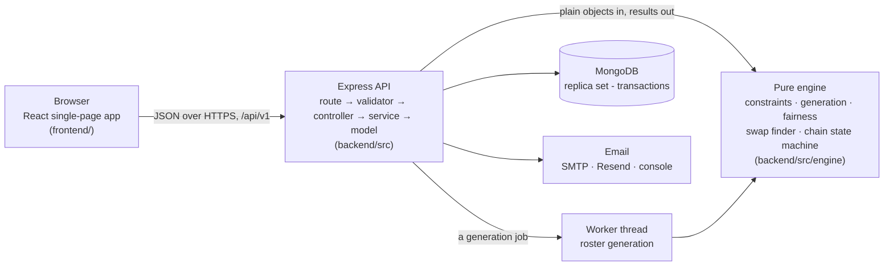

# Relay

Relay builds staff rosters that keep every scheduling rule - rest between shifts, consecutive days, weekly hours, qualifications, declared unavailability - and explains, in plain words, any shift it cannot fill without breaking one. Staff then swap shifts directly or through a chain of colleagues, with every swap checked against the same rules before it happens, and Relay keeps a running record of who has carried the nights and weekends so the next roster evens it out.

**Live demo:** _placeholder - the link is added here once Relay is deployed._

> **Working on this repo with an AI agent?** Read [AGENTS.md](AGENTS.md) first. It sets the hard rules - no curl, no live database, no test data - and the project conventions.

- [What it does](#what-it-does)
- [Architecture](#architecture)
- [How the engine works](#how-the-engine-works)
- [Measured results](#measured-results-generated-scenarios)
- [How it is tested](#how-it-is-tested)
- [The public demo, and keeping it safe](#the-public-demo-and-keeping-it-safe)
- [Known gaps](#known-gaps)
- [Running it locally](#running-it-locally)
- [Deploying it](#deploying-it)

## What it does

- **Rosters.** A manager describes the work - qualifications, shift templates, how many people each shift needs on each weekday - and the rules. Relay generates a roster in the background, lists every slot it could not fill with the rule that stopped each person, and checks every hand edit against the same rules before saving it. Publishing shows the roster to the team.
- **Fairness.** Each person's share of nights, evenings and weekends over the last 12 weeks of published rosters, compared per full-time week, so a part-timer is not measured against a full-timer's total. Managers see everyone; a worker sees only themselves against the team average, enforced on the server. The generator steers heavy shifts away from whoever is above their share.
- **Swaps.** A worker offers a shift they cannot work. Relay finds direct swaps and chains of up to four people in which each takes the next one's shift, ranked and drawn as a diagram. The person who offered proposes one; everyone in it accepts; a manager approves if the organisation asks for that; then every shift changes hands at once, or none does.
- **Notifications.** A bell in the app for rosters published and swaps at each step, and email for the three that cannot wait: a swap proposed to you, a swap waiting for your approval, and a roster with your shifts on it.

## Architecture



- **The engine is pure.** Everything under `backend/src/engine/` takes plain objects and returns plain objects: no database, no configuration, no I/O, no clock reads, no randomness except a seeded generator. Time is injected as a `now()` function. An ESLint rule enforces it - importing Mongoose, a model, config or a service, or calling `Date.now()`, `new Date()` or `Math.random()` there fails the lint. So the generator, manual edits and the swap finder all ask the same code the same question, and nothing can drift between them.
- **Generation runs off the request.** Starting a generation answers at once with a job id; a worker thread does the work within a time and iteration budget, and the frontend polls the job.
- **Every refusal is the server's.** The frontend hides what a person may not do, but every rule - roles, tenancy, the demo's locks, the limits - is enforced on the server.
- **Multi-tenant by organisation.** Every organisation-scoped request is checked against the caller's membership, and another organisation's anything is "not found" - never "forbidden", which would confirm it exists. A fuzzer proves it for every route ([How it is tested](#how-it-is-tested)).

## How the engine works

### Constraints

`evaluate(assignments, context)` is the single entry point (`backend/src/engine/constraints/evaluate.js`), and it never throws: malformed input becomes a violation, not an exception. Six **hard** constraints decide legality - qualification match (the person holds the role the slot needs), declared unavailability, no double booking, minimum rest, maximum consecutive days, and maximum hours in any rolling seven days. Three **soft** ones score a legal roster - preferences (avoid / prefer), pattern continuity, and fairness debt. Durations come from real instants in the organisation's timezone, so a night across a clock change counts its real 7 or 9 hours.

### Generation

Coverage rules are expanded into concrete slots; a greedy pass fills them, preferring to leave a slot empty rather than break a rule; then a seeded hill-climbing search with restarts improves the result within the budget, asking `evaluate()` about every candidate rather than assuming a move is legal. Every unfilled slot comes back with the reason - which rule stopped how many people - in a sentence a manager can act on.

### Fairness feedback

Publishing a roster recomputes each member's burden over the last 12 weeks of published rosters: weighted shift counts (nights, evenings and weekends heavier), normalised per full-time week. The difference from the team average becomes **fairness debt**, which the next generation reads as a soft constraint - so whoever carried more is given less, and the spread narrows period by period ([the table below](#fairness-convergence)).

### The swap chain finder

An offered shift becomes a node in a graph of who could take whose shift; chains are cycles in it, up to the organisation's longest-chain setting (four people). Every candidate hand-over is checked with the same constraint engine on each person's **whole week after the swap**, so a swap that is only legal because of what that person gives away is found, and one that breaks a rule once the rest of their week counts is refused. The search is capped - nodes, cycles, and a 400 ms budget on an injected clock - and says when it was cut short. Options are ranked by size, then avoid/prefer wishes, then fairness; when there are none, the reasons come with counts.

### Atomic commit and the chain state machine

Proposing searches again from scratch - the client's chain is never trusted - and reserves every shift in one transaction, each only if no unexpired proposal holds it and it is the very version the search checked. Every status change goes through one pure function, `transition(chain, event, now)` in `backend/src/engine/swaps/chainStateMachine.js`; services store what it returns and never set a status themselves, and every write names the status and revision it read, so two simultaneous final acceptances commit exactly once. The commit is one transaction that re-checks every shift and every rule, then hands each shift over; a refused commit leaves everything where it was and says why. Expiry is read from stored deadlines, never timers.

| From | Event | Condition | To |
| --- | --- | --- | --- |
| proposed or awaiting_approval | any event | now is at or past `expiresAt` | expired |
| proposed | accept(member) | someone in it, others still to accept | proposed |
| proposed | accept(member) | the last to accept; approval required | awaiting_approval |
| proposed | accept(member) | the last to accept; no approval | proposed, ready to commit |
| proposed or awaiting_approval | accept(member) | already accepted | no change |
| proposed or awaiting_approval | decline(member) | someone in it | declined |
| proposed or awaiting_approval | cancel(member) | the proposer | cancelled |
| awaiting_approval | approve(manager) | - | awaiting_approval, ready to commit |
| awaiting_approval | reject(manager) | - | declined |
| ready to commit | committed | every commit check passed | committed |
| ready to commit | commitFailed(reason) | a commit check failed | failed |
| proposed | approve or reject | - | refused: not waiting for approval |
| proposed or awaiting_approval | expire | before `expiresAt` | refused: not due yet |
| any | accept or decline by someone not in it; cancel by anyone but the proposer | - | refused |
| a terminal state | the action that ended it again (or accept on committed) | - | no change, same answer |
| a terminal state | anything else | - | refused |

## Measured results (generated scenarios)

Every number here comes from generated scenarios defined in code (`backend/scripts/`), not from a real ward or real users. Each scenario uses a fixed seed, so a change in a table comes from a change in the code.

### Generation harness

`npm run evaluate` runs the generator over five fixed scenarios with the default weights. Times are milliseconds on a laptop and vary from run to run; every other column is the same on every run.

| Scenario | Slots | Filled | Unfilled | Objective | Iterations | ms | Legal |
| --- | ---: | ---: | ---: | ---: | ---: | ---: | --- |
| Hospital ward (40 staff, 14 days) | 168 | 168 | 0 | 4 | 4000 | 1657 | yes |
| Ward with heavy availability constraints | 168 | 154 | 14 | 140002 | 4000 | 3099 | yes |
| Understaffed ward (infeasible on purpose) | 168 | 144 | 24 | 240115 | 4000 | 1278 | yes |
| Small cafe (8 staff, 7 days) | 28 | 28 | 0 | 0 | 4000 | 200 | yes |
| Ward across a DST change (28 days) | 336 | 336 | 0 | 45 | 4000 | 2536 | yes |

Every roster is legal, including the understaffed one, which leaves 24 slots empty rather than break a rule.

### Fairness convergence

The 40-person ward, rostered for four consecutive 14-day periods. After each period its roster is treated as published history and the resulting fairness debt is fed into the next, exactly as the app does. Both runs use the same seeds; the spread is the standard deviation and the max - min of normalised burden (burden per full-time week) over all history so far. Every slot was filled in every period, both ways (`npm run evaluate:fairness`).

| Period | Feedback on: std dev | max - min | Feedback off: std dev | max - min |
| --- | ---: | ---: | ---: | ---: |
| 1 (2 - 15 Mar 2026) | 0.573 | 2.507 | 0.573 | 2.507 |
| 2 (16 - 29 Mar) | 0.378 | 2.227 | 0.441 | 2.040 |
| 3 (30 Mar - 12 Apr) | 0.302 | 1.316 | 0.431 | 2.116 |
| 4 (13 - 26 Apr) | 0.220 | 1.020 | 0.407 | 1.687 |

With feedback the spread narrows every period, ending at 54% of the spread without it, and does not oscillate. It works by making each new roster deliberately uneven in favour of whoever carried less before, so in the first corrected period 5 of the 40 people swing from more than 5% over the average to more than 5% under; after that, one per period.

### Swap options benchmark

`npm run benchmark:swaps` measures how often a swap request can be resolved - by a direct swap, or by a chain of up to L people - how often **only** a chain resolves it, and how long a search takes.

**The scenarios, written down before the first run and not changed after seeing the results** (`backend/scripts/swapBenchmarkWards.js` and `swapBenchmarkPools.js`):

- **The harness wards**: the 40-person hospital ward, the ward with heavy availability constraints, and the understaffed 12-person ward. Offers take any shift.
- **The mixed-role ward**: 40 people - 8 charge nurses (who are also registered nurses), 16 registered nurses and 16 healthcare assistants - where every shift needs particular roles: Day 1 charge nurse + 3 RN + 3 HCA, Evening 1 + 2 + 2, Night 1 + 1 + 2.
- **The willingness sweep**, on the mixed-role ward: every offer says it would take a share of shift types and weekdays in return - 100%, 60%, 30% or 15% (12, 6 and 3 of the 21 type-and-weekday pairs for the last three). Every share asks about exactly the same pools; only the filters differ.
- **For each**: 30 random pools of 5, 10 and 20 offers, every offer asking at a maximum chain length of 2, 3 and 4, exactly as the options endpoint searches.
- **The performance target**: the hospital ward with 100 staff, all 100 offering a shift at once, L = 4, with fairness debts and preferences to weigh - each search under 500 ms.

The columns are the share of requests with a direct swap, with any option once chains of up to three or four people count, and with an option **only** a chain gives (at L = 4); times are per search at L = 4, from a laptop (an Intel Core i7-1255U) on battery. The percentages do not depend on the machine.

The harness wards, offers taking any shift:

| Ward | Offers | Direct | Up to 3 people | Up to 4 people | Only by a chain | Median ms | p95 ms |
| --- | ---: | ---: | ---: | ---: | ---: | ---: | ---: |
| Hospital ward (40 staff) | 5 | 72.7% | 76.0% | 76.7% | 4.0% | 1.0 | 2.9 |
| Hospital ward (40 staff) | 10 | 91.0% | 93.0% | 93.0% | 2.0% | 2.0 | 3.6 |
| Hospital ward (40 staff) | 20 | 95.7% | 98.7% | 98.7% | 3.0% | 6.0 | 9.4 |
| Heavy availability (40 staff) | 5 | 79.3% | 84.0% | 84.0% | 4.7% | 0.8 | 1.8 |
| Heavy availability (40 staff) | 10 | 93.7% | 94.3% | 94.7% | 1.0% | 2.0 | 3.3 |
| Heavy availability (40 staff) | 20 | 98.5% | 99.7% | 99.7% | 1.2% | 6.2 | 9.9 |
| Understaffed (12 staff) | 5 | 5.3% | 5.3% | 5.3% | 0.0% | 0.5 | 0.8 |
| Understaffed (12 staff) | 10 | 11.3% | 11.3% | 11.3% | 0.0% | 1.3 | 2.3 |

The mixed-role ward, by how much of what is on offer each person would take:

| Willingness | Offers | Direct | Up to 3 people | Up to 4 people | Only by a chain | Median ms | p95 ms |
| --- | ---: | ---: | ---: | ---: | ---: | ---: | ---: |
| 100% | 5 | 36.0% | 42.0% | 42.0% | 6.0% | 0.4 | 1.2 |
| 100% | 10 | 69.3% | 78.3% | 80.7% | 11.3% | 1.3 | 2.7 |
| 100% | 20 | 86.0% | 94.2% | 95.2% | 9.2% | 4.3 | 6.3 |
| 60% | 5 | 14.7% | 17.3% | 18.0% | 3.3% | 0.3 | 0.6 |
| 60% | 10 | 35.7% | 44.3% | 47.0% | 11.3% | 1.1 | 2.0 |
| 60% | 20 | 50.8% | 67.7% | 73.2% | 22.3% | 3.6 | 5.5 |
| 30% | 5 | 4.0% | 4.0% | 4.0% | 0.0% | 0.3 | 1.0 |
| 30% | 10 | 9.3% | 11.0% | 11.7% | 2.3% | 0.8 | 1.7 |
| 30% | 20 | 17.7% | 25.5% | 31.3% | 13.7% | 3.1 | 4.9 |
| 15% | 5 | 0.0% | 0.0% | 0.0% | 0.0% | 0.3 | 0.7 |
| 15% | 10 | 2.7% | 3.7% | 3.7% | 1.0% | 0.8 | 1.8 |
| 15% | 20 | 6.8% | 10.0% | 11.5% | 4.7% | 3.1 | 4.7 |

What it says, plainly:

- **Where anyone can take almost anything, chains add little.** In the harness wards a direct swap usually exists, and chains add 1 to 5 points. In the understaffed ward everyone is at their limits and chains add nothing.
- **Roles alone make chains worth having.** In the mixed-role ward a charge nurse's shift can go to only 8 people, so direct swaps drop to 36% with five offers, and chains add 6 to 11 points.
- **Choosy people are where chains matter most.** With everyone taking 60% of what is on offer and 20 offers out, chains resolve 22 points more than direct swaps alone (51% to 73%); at 30%, they almost double it (18% to 31%).
- **The limit is the pool, not the search.** With five offers and choosy people almost nothing resolves however long a chain may be.

The performance target held: across 300 searches with all 100 people offering, the median was 181 ms, p95 251 ms and the slowest 360 ms on battery (60, 80 and 97 ms plugged in), and none reached the 400 ms budget. A free-tier server has far less CPU, so this still needs measuring there.

## How it is tested

At the time of writing: **608 backend tests** in 137 files (Vitest, every file against an in-memory MongoDB replica set of its own), **91 frontend tests** (Vitest, components in a browser-like DOM), and the end-to-end suite below. All of it runs on every push.

- **Property-based tests with non-vacuity checks.** [fast-check](https://fast-check.dev) generates hundreds of organisations, rosters, teams, offers and chain histories per property - half-hour and 45-minute timezones, clock changes, shifts that end exactly when the next begins - and checks invariants that must hold for every one of them: whatever the generator produces is legal; removing a shift never adds a hard violation; `canAssign` agrees with `evaluate`; the swap finder only ever offers legal swaps; the chain state machine never commits twice. A property that passes because its cases never reach the situation it is about proves nothing, so separate **vacuity tests** sample the same generators and fail unless each outcome - a swap found, only a chain, nothing at all, each way a chain can end - turns up often enough.
- **Concurrency tests.** Requests fired at the same moment (`Promise.all`), several rounds each from a fresh world: two proposals racing for one shift (exactly one wins, the other gets 409), two final acceptances at once (exactly one commit), a duplicate approval (one commit, both answered).
- **The tenancy fuzzer.** It reads the route list from the Express router itself - 73 routes - builds two organisations with something of everything, and for every organisation-scoped route calls it as organisation A's owner with organisation B's id, and again with B's records under A's id, expecting 404 every time: never 200, never 403, never 500. Every non-public route must answer 401 without a token, and the test fails if a route exists that it did not exercise, so a new route cannot slip past it. On its first run it found two routes that accepted another organisation's member id; both now answer 404.
- **Planted-bug checks.** A safety net is trusted only after it has been seen to fail: with the organisation filter removed from revoking an invite, the fuzzer fails, naming that route; and code planted in the engine that imports Mongoose, a model, config or a service, or reads the clock or `Math.random()`, fails the lint on every one of those lines.
- **Abuse limits and security.** Each limit is tested to refuse with 429 and a sentence saying when to try again; production settings that would be unsafe stop the server starting; production error responses carry no stack traces or internal details; request logs never hold a token, a reset or invite link, or the refresh cookie; the refresh cookie is checked as a production server sets it; and a production server that sends no email says so at `GET /api/v1/config`, refuses a password reset with `EMAIL_DISABLED` without creating a token, and hands an invite back as a link without trying to email it.
- **End to end, and accessibility.** **55 end-to-end tests** in 21 spec files. [Playwright](https://playwright.dev) drives the built app in a real browser against an in-memory database filled by the demo seed: signing in, the roster grid by keyboard, illegal edits refused, two managers saving at once, publishing with holes, the fairness numbers against the raw ledger, swaps proposed, accepted and approved in separate browsers (one on a phone), notifications, the public demo's accounts and locks, what a first visit asks of the API, and no sideways scrolling at 375px. The build is served with the deployment's security headers (`frontend/vercel.json`), so every page runs under the production Content-Security-Policy, and anything it blocks fails the test - in every spec but the accessibility one, whose checker fetches stylesheets itself. [axe](https://github.com/dequelabs/axe-core) checks the main pages in light and dark themes against WCAG 2.1 A and AA - 28 page-and-theme checks, which at the time of writing find nothing at any severity - and the run fails on any serious or critical problem.
- **CI.** GitHub Actions runs a secret scan of the whole history, lint, the backend and frontend tests and the build on every push and pull request, then the end-to-end suite on Playwright's Chromium.

## The public demo, and keeping it safe

Visitors share one demo organisation - a hospital ward built by `npm run seed:demo` - which the nightly workflow (`.github/workflows/nightly.yml`) reseeds at 03:00 IST once Relay is deployed. With `VITE_DEMO_MODE=true` at build time, the login page lists three of its accounts with a button that signs straight in: the owner, a worker with a swap waiting, and a worker with a direct swap. Its setup is locked on the server - invites, members, the scheduling and swap rules, qualifications, shift templates and coverage answer `DEMO_LOCKED` - while everything it is for stays open: generating and editing drafts, publishing, availability, swaps, notifications, fairness. Its accounts cannot create or join other organisations, are never locked out by wrong passwords (their password is public), and are never sent real email (`relay.test` is a reserved domain that cannot receive it). The reseed touches only the demo organisation and its accounts: a test seeds the demo beside a real organisation, reseeds, and finds the real one unchanged, document for document.

Limits for strangers, each answering 429 with when to try again: per address across the API and on the sign-in endpoints; five new accounts per address per hour; three reset emails per email address per hour; 20 invites per organisation per day; five organisations per account, ever; ten swap proposals per person per hour; ten swap searches per person per minute. The server takes the client's address from `X-Forwarded-For` only as far as `TRUST_PROXY` says proxies stand in front of it. In production it refuses to start unless `FRONTEND_URL` is https, the two JWT secrets are long and different, and the job secret is set; answers cross-origin requests from the frontend alone; and keeps the refresh cookie `HttpOnly`, `Secure`, `SameSite=Strict`, host-only and scoped to `/api/v1/auth`.

## Known gaps

- The generator does not hold anyone to their contracted hours. Only the maximum hours per week is a hard limit; contracts act through fairness debt.
- An invite link can be copied again only in the browser tab that created it: the server keeps just a hash of each link.
- Swap ranking measures fairness as how far the people in a swap together sit from a fair share, so moving burden among people who are all over (or all under) their share counts as no change.
- The reaper for expired swap reservations runs once a night, from the nightly workflow; between runs, an expired proposal nobody looks at stays stored as proposed - though anyone who reads or acts on it finds it expired.
- Notifications arrive through the bell, which checks every 30 seconds while the tab is visible, and by email where the server sends it; nothing is pushed. Each email is sent once and never retried, and real delivery needs SMTP or Resend. The deployed demo sends none - its host blocks SMTP - so there invites are shared as links, password reset by email is unavailable, and notifications stay in the app. Notifications are deleted 90 days after they are written.
- The per-request limits are counted in memory, per server process, and start again after a restart; the ones that matter most for abuse (invites, proposals, organisations) are counted in the database.
- Search and generation times were measured on a laptop, not on the deployed server.

## Running it locally

```bash
npm install
cp backend/.env.example backend/.env   # optional in development
npm run dev                            # backend :4917 + frontend :5173
```

`/api` is proxied from the Vite dev server to the backend, so the frontend calls relative paths. The database needs to be a replica set (Atlas is one), since organisation creation and swaps use transactions; `cd backend && npm run db:check` is a read-only check that explains any connection failure. `backend/.env.example` and `frontend/.env.example` describe every setting.

| Command | What it does |
| --- | --- |
| `npm run dev` | Runs both workspaces |
| `npm test` | Backend tests (Vitest + mongodb-memory-server), then the frontend's |
| `npm run lint` | ESLint across both workspaces |
| `npm run build` | Production build of the frontend |
| `npm run e2e` | The end-to-end suite in a real browser, against an in-memory database |
| `npm run scan:secrets` | The secret scan CI runs, over the whole git history |
| `npm run evaluate`, `evaluate:fairness`, `benchmark:swaps` (in `backend/`) | The measured results above |

**Demo data.** `cd backend && npm run seed:demo -- --yes` fills a database whose name ends in `-demo` with the demo ward: an owner, a manager and twelve nurses and healthcare assistants on `relay.test` addresses (password `relay-demo-2026`, printed by the script), five published weeks generated by the real engine, a two-week draft, six open swap requests showing each kind of answer the finder gives, and two proposed swaps. The data is the same on every run - only the dates move - and so are the people in each story: `dara@relay.test` has a request only a three-person chain resolves, `elif@relay.test` a direct swap, `grace@relay.test` none because of the days she cannot work, `bilal@relay.test` a charge nurse shift nobody offering could take, `jonas@relay.test` a proposed swap to answer, and the owner or manager a swap to approve. It refuses to run without `--yes` or against a database not named `...-demo`, and each run removes only what the last run made - found by fixed ids, never by anything another organisation could share.

**End-to-end tests.** `npm install --prefix e2e` once, then `npm run e2e` - it builds the frontend in demo mode, starts the backend and a preview server on free ports against an in-memory database filled by the demo seed, runs every spec in order, and tears it all down (about six minutes). It uses the Microsoft Edge already on the machine; without Edge, `npx --prefix e2e playwright install chromium` and run with `E2E_CHANNEL=chromium`. Reports, screenshots and measured figures land in `e2e/artifacts/`, which git ignores.

## Deploying it

The public demo runs on free tiers: the frontend on Vercel, which passes `/api` on to the API on a free Render web service, the data in its own database on the Atlas free cluster, and a nightly GitHub Actions workflow that releases expired swap reservations and reseeds the demo. The deployed site sends no email. [docs/deploy/DEPLOY.md](docs/deploy/DEPLOY.md) is the step-by-step guide - Atlas, the secrets, Vercel, the Render Blueprint (`render.yaml`), the one line to change in `frontend/vercel.json`, the workflow's secrets, the smoke test (`node scripts/smoke-deployed.mjs https://<your-app>.vercel.app`) and checking `TRUST_PROXY` - with a troubleshooting table and what the server was measured to need on the free plan's 512 MB.
